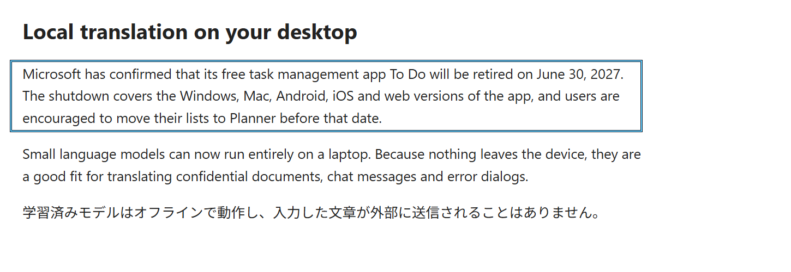
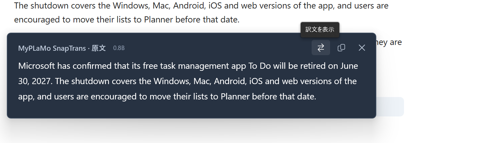

# MyPLaMo SnapTrans

[日本語](#日本語) | [English](#english)

**Built with PLaMo**

> 株式会社 Preferred Networks が公開した翻訳モデル「PLaMo 3 Translate」を使用する、個人開発の非公式アプリです。株式会社 Preferred Networks による提供・推奨・提携はありません。
>
> An unofficial, independently developed app that uses the PLaMo 3 Translate model released by Preferred Networks, Inc. It is not provided, endorsed, or affiliated with Preferred Networks, Inc.


---

## 日本語

### 概要

MyPLaMo SnapTrans は、画面の文字をドラッグで囲むと、その場で翻訳するタスクトレイ常駐アプリです（Windows 版）。

- 文字の読み取り（OCR）は Windows OCR、翻訳は Preferred Networks の翻訳モデル **PLaMo 3 Translate** を [llama.cpp](https://github.com/ggml-org/llama.cpp) で動かして行います。どちらもこの PC の中で処理し、文章を外部に送りません。
- インストール不要。ZIP を展開して起動するだけです（.NET や Windows App SDK のランタイムは同梱）。
- モデルは同梱していません。初回に設定画面でライセンスに同意し、PFN の Hugging Face から直接ダウンロードします。




### 動作環境

| 項目 | 内容 |
| --- | --- |
| OS | Windows 10 (2004 以降) / Windows 11、64 ビット (x64) |
| メモリ | 8 GB 以上を推奨（8B / 31B モデルはさらに必要） |
| GPU | 任意。NVIDIA / AMD / Intel（Vulkan 対応）なら高速。NVIDIA は CUDA エンジンも導入できます。GPU がなくても CPU で動きます |
| ディスク | 本体 約 380 MB、モデル 0.6 GB（0.8B）〜 19.5 GB（31B） |
| ネットワーク | モデル（と任意の CUDA エンジン・Tesseract 辞書）のダウンロード時だけ必要 |

### インストール

1. [Releases](../../releases) から `MyPLaMo-SnapTrans-<version>-win-x64.zip` をダウンロードします。必要なら同じ場所の `.sha256` でハッシュを確認します（`Get-FileHash <zip> -Algorithm SHA256`）。
2. ZIP を好きな場所（例: `C:\Tools`）に展開します。
3. `MyPLaMo-SnapTrans\MyPLaMo-SnapTrans.exe` を起動します。通知領域にアイコンが出ます。

展開したフォルダーの中身:

```
MyPLaMo-SnapTrans\
  MyPLaMo-SnapTrans.exe      起動用（app\MyPLaMo.SnapTrans.exe を起動するだけの小さな exe）
  README.txt                 利用者向けの説明
  LICENSE.txt                このアプリのライセンス
  THIRD-PARTY-NOTICES.txt    同梱しているソフトウェアのライセンス
  app\                       本体とランタイム一式、推論エンジン（engine\）
```

`app` フォルダーは消したり移動したりせず、フォルダーごと置いてください。`app\MyPLaMo.SnapTrans.exe` を直接起動しても同じです。

#### 「Windows によって PC が保護されました」と表示されたら

このアプリはコード署名されていないため、初回起動時に Microsoft Defender SmartScreen が「発行元: 不明」と警告することがあります。配布元（このリポジトリの Releases）を信頼できる場合は、「**詳細情報**」→「**実行**」で起動できます。ZIP のプロパティで「ブロックの解除」にチェックしてから展開しても、警告は出なくなります。

### アンインストールとデータの消し方

1. 通知領域のアイコンを右クリックして「終了」します。
2. 展開したフォルダー（`MyPLaMo-SnapTrans`）を削除します。
3. データも消す場合は、次を削除します。

| データ | 場所 |
| --- | --- |
| 設定（`settings.json`）、ログ（`snaptrans.log` と `snaptrans.log.1`）、モデルの検証結果（`verify-cache.json`） | `%LOCALAPPDATA%\MyPLaMo-SnapTrans\` |
| CUDA エンジン（任意で導入した場合） | `%LOCALAPPDATA%\MyPLaMo-SnapTrans\engine\cuda\` |
| Tesseract の言語データ（任意で取得した場合） | `%LOCALAPPDATA%\MyPLaMo-SnapTrans\tessdata\` |
| 翻訳モデル（`*.gguf`） | 設定画面の「保存先」。既定は `%LOCALAPPDATA%\MyPLaMo-SnapTrans\models\` |

`%LOCALAPPDATA%\MyPLaMo-SnapTrans` フォルダーごと削除すれば、既定の場所のデータはすべて消えます。保存先を別のフォルダーにした場合は、そのフォルダーのモデルを個別に削除してください（他のアプリと共有しているフォルダーなら、そのアプリのファイルは残してください）。アプリはレジストリに書き込まず、`app` フォルダーの中にも何も書き込みません。

### 使い方

1. 初回は設定画面が開きます。「PLaMo コミュニティライセンスを読む」でライセンスを確認し、「ライセンスを確認し、同意します」にチェックを付けてから、モデル（まずは 0.8B か 2B）の「ダウンロード」を押します。
2. **Ctrl + Alt を押しながら画面上の文字を左ドラッグ**で囲みます。離すと、その範囲を OCR で読み取って翻訳し、ポップアップに表示します。
   - ドラッグ中のクリックは下のアプリに届きません。ドラッグ中に Esc でキャンセルします。
   - ポップアップ: 原文⇄訳文の切り替え、コピー、×（Esc でも可）で閉じる。カードをドラッグすると移動できます。
3. 通知領域のアイコン: クリックで設定、右クリックで「設定を開く / 最後の翻訳を表示 / ドラッグ翻訳を有効にする / 終了」。起動中にもう一度 exe を起動すると、設定画面が開きます（二重には起動しません）。



### 設定

| 項目 | 内容 |
| --- | --- |
| 翻訳モデル | plamo-3-translate 0.8B / 2B / 8B / 31B（PFN 公式 GGUF Q4_K_M）のダウンロード・中断・再開・SHA-256 検証・選択・削除。保存先は任意。 |
| 実行デバイス | 自動（CUDA → Vulkan → CPU）/ CPU のみ / 検出した各 GPU。GPU で読み込めない場合は CPU に切り替え、理由を表示します。 |
| CUDA エンジン | 任意。NVIDIA GPU 用。llama.cpp 公式リリースから取得・検証して導入します。 |
| ショートカット | Ctrl / Alt / Shift / Win の組み合わせ（＋左ドラッグ）。 |
| 翻訳 | 訳先: 自動（日本語→英語、それ以外→日本語）または言語を指定。 |
| OCR | Windows OCR（標準）/ Tesseract（日本語・英語の辞書を設定から取得）。OCR の言語: 自動または指定。 |
| 表示 | 表示言語（自動 / 日本語 / English）、テーマ（システム / ライト / ダーク）。 |

### OCR の読み取り精度を上げる

SnapTrans は、選んだ範囲を Windows の OCR で読み取ります。精度は、翻訳したい文章の言語の OCR が Windows に入っているかどうかで変わります。

- 英語の画面を訳す場合は、Windows の **設定 → 時刻と言語 → 言語と地域 → 言語の追加** で **英語（米国）** を追加し、言語機能のダウンロードが終わるまで待ちます。すでに一覧にある言語は、**… → 言語のオプション** で OCR が入っているか確認できます。
- 追加した OCR 言語は SnapTrans が自動で使います。「自動」では、日本語の行を日本語の認識器で、それ以外の行をラテン文字の認識器で読みます。
- 設定画面の **Windows の言語設定を開く** ボタンでそのページが開きます。SnapTrans は Windows の設定を変更しません。
- 読み取った文字はポップアップの切り替えボタン（「原文を表示」）で確認できます。小さすぎる文字は、画面を拡大してから囲むと読みやすくなります。
- 絵文字やアイコン、画面キャプチャを禁止しているウィンドウは、正しく読み取れないことがあります。


### GPU / CPU

- 「自動」では CUDA（導入済みの場合）→ Vulkan → CPU の順に使えるものを選びます。Vulkan 版は NVIDIA / AMD / Intel の GPU で動き、追加の導入は要りません。
- GPU のメモリが足りないなどで読み込めない場合は CPU に切り替え、ポップアップの警告アイコンと通知で理由を知らせます。
- 計測例（Ryzen 9 9950X / RTX 5090、英文 251 文字 → 日本語、読み込み後 3 回の中央値）:

| モデル | RTX 5090 CUDA | RTX 5090 Vulkan | CPU | 内蔵 Radeon (Vulkan) |
| --- | ---: | ---: | ---: | ---: |
| 0.8B | 0.077 s | 0.081 s | 0.569 s | 1.405 s |
| 2B | 0.151 s | 0.162 s | 2.093 s | 4.663 s |

画面のドラッグ終了からポップアップ表示まで: 0.36〜0.50 秒（0.8B / GPU、OCR 0.15〜0.28 秒を含む）。

### モデルとダウンロード

| モデル | サイズ | 目安 |
| --- | ---: | --- |
| plamo-3-translate-0.8b | 0.57 GB | 軽量。まずはこれ |
| plamo-3-translate-2b | 1.8 GB | 高品質 |
| plamo-3-translate-8b | 5.3 GB | メモリに余裕がある PC 向け |
| plamo-3-translate-31b | 19.5 GB | GPU メモリ 24 GB 以上を推奨 |

- モデルは [PFN の Hugging Face](https://huggingface.co/pfnet) の公式 GGUF（Q4_K_M）を、ユーザーの操作で直接ダウンロードします。ダウンロードの前に PLaMo コミュニティライセンスへの同意が必要です（設定画面のチェックボックス）。
- ダウンロードは中断・再開でき、完了後にサイズと SHA-256 を検証します。検証結果はプロファイル（`verify-cache.json`）に保存し、モデルの保存先には書き込みません。
- PFN は GGUF に埋め込むチャットテンプレートを何度か更新しています。古い公式版は「旧版・使用できます」と表示してそのまま使えます。「最新版を取得」で置き換えられます。
- 保存先を他のアプリ（MyPLaMo など）のモデルフォルダーにすると、そのモデルを共有できます。そのフォルダーに書き込むのはダウンロード・更新・削除のときだけで、事前に確認を出します。
- ほかの人も書き込める保存先（`D:\` などの追加ドライブは、既定でそうなっていることが多い）では、起動時とモデルの読み込み時に毎回 SHA-256 を確認します。このため、大きいモデルほど読み込みが数秒〜十数秒長くなります（目安: 0.8B 約 0.3 秒、2B 約 1 秒、8B 約 3 秒、31B 約 12 秒）。既定の `%LOCALAPPDATA%` のように本人と管理者しか書けない場所では、サイズと更新日時が同じなら前回の検証結果を使います。

### 安全のための仕組み

- **推論エンジンの照合**: 起動の前に（GPU 一覧の取得を含む）、llama.cpp b12121 の公式ファイル（cpu / vulkan / cuda の exe と DLL）の SHA-256 と照合します。一覧にない exe / DLL があるフォルダーや、内容が違うファイルは使いません。照合したファイルは、使っている間は書き換えや削除ができないように開いたままにします。
- **VC++ ランタイム**: 同梱している `msvcp140.dll`・`vcruntime140.dll`・`vcruntime140_1.dll` は、Microsoft Corporation の署名を確認します（オフライン）。CUDA エンジンを導入するときは、この 3 つを `engine\vulkan` からコピーして同じように確認します。
- **llama-server との通信**: llama-server は 127.0.0.1 のランダムなポートで、API キー付きで起動します（キーはコマンドラインに載せません）。送信の前に毎回、そのポートで待ち受けているのが自分の起動した llama-server であることを確かめ、違えば送らずに別のポートで起動し直します。
- **Tesseract の言語データ**: tesseract-ocr/tessdata_fast 4.1.0（コミット 65727574）の eng / jpn を取得し、SHA-256 とサイズを照合してから保存します。初回に使う前にも照合します。
- **翻訳モデル**: サイズと SHA-256 を確認したモデルだけを使います（「モデルとダウンロード」を参照）。
- **ログ**: `%LOCALAPPDATA%\MyPLaMo-SnapTrans\snaptrans.log`。1 MB を超えると `snaptrans.log.1` に退避します（1 世代だけ）。記録するのは、時刻・処理時間・言語・デバイス名・文字数・エラーの種類だけです。読み取った文字、訳文、ファイルのパス、API キーは記録しません。直近の原文と訳文はメモリにだけ置き、終了時に消します。

### トラブルシューティング

| 症状 | 対処 |
| --- | --- |
| 起動時に「Windows によって PC が保護されました」 | 「詳細情報」→「実行」（上記）。 |
| Ctrl + Alt でドラッグしても枠が出ない | 通知領域の右クリックメニューで「ドラッグ翻訳を有効にする」にチェックが付いているか確認。設定画面にフックの設置失敗が表示されていないか確認。ほかのアプリが同じキーの組み合わせを使っていれば、設定でショートカットを変えます。管理者として実行中のウィンドウの上では動きません。 |
| 「文字を読み取れませんでした」 / 読み取りがおかしい | 「OCR の読み取り精度を上げる」を参照。OCR エンジンを Tesseract に切り替えるのも手です。 |
| GPU が使われない / CPU に切り替わった | ポップアップの警告アイコンのツールチップに理由が出ます。GPU ドライバーを更新するか、小さいモデルを選びます。設定の「GPU 一覧を更新」で再検出します。 |
| モデルが「壊れています」 | 削除してダウンロードし直します。 |
| ダウンロードが失敗する | ネットワークやプロキシを確認し、もう一度「ダウンロード」を押すと続きから再開します。 |
| アイコンが通知領域に見えない | タスクバーの「^」（隠れているインジケーター）の中にあります。タスクバーの設定で常に表示にできます。 |
| ログを見たい | `%LOCALAPPDATA%\MyPLaMo-SnapTrans\snaptrans.log`（下の「安全のための仕組み」を参照）。 |

### ビルド

必要なもの: Windows 10/11 x64、[.NET 10 SDK](https://dotnet.microsoft.com/download)、PowerShell 7、Visual Studio 2022 以降の「C++ によるデスクトップ開発」（ランチャーの Native AOT ビルドと VC++ ランタイムの同梱に使用）。

```powershell
# 配布用 ZIP（dist\MyPLaMo-SnapTrans-<version>-win-x64.zip と .sha256）
pwsh -File packaging\package.ps1                 # バージョンは Directory.Build.props
pwsh -File packaging\package.ps1 -Version 1.0.0

# 開発用（ランチャーなしの発行フォルダー release\MyPLaMo-SnapTrans\）
pwsh -File build.ps1
```

- `scripts/Prepare-Engine.ps1` が llama.cpp b12121（Vulkan 版）を取得・SHA-256 を照合し、`engine/cpu` と `engine/vulkan` を作ります（`package.ps1` と `build.ps1` が自動で呼びます）。
- `package.ps1` は、モデル・PDB・ログ・設定ファイルが入っていないこと、ビルドした PC のユーザー名やパスが含まれていないことを確認してから ZIP を作ります。
- アイコンは `assets/icon/*.svg` から `scripts/Make-Icon.ps1` で `src/SnapTrans.App/Assets/` に書き出します（`-Check` でコミット済みのものと同じか確認）。

構成:

```
src/
  SnapTrans.Core           OCR / 翻訳のインターフェース、PFML3 プロンプト、モデルカタログとダウンロード（再開・SHA-256）
  SnapTrans.Llama          llama-server 子プロセス（127.0.0.1・ランダムポート・API キー・ジョブオブジェクト）、GPU 列挙、CUDA エンジン導入
  SnapTrans.Ocr.Windows    Windows.Media.Ocr 実装
  SnapTrans.Ocr.Tesseract  Tesseract 5 実装（任意）
  SnapTrans.App            WinUI 3 アプリ（トレイ、設定、ポップアップ、選択枠）
  SnapTrans.Launcher       配布 ZIP 最上位の起動用 exe（Native AOT）
tools/SnapTrans.Bench      モデル取得・GPU 列挙・OCR 比較・翻訳時間計測の CLI
packaging/                 package.ps1、README.txt、THIRD-PARTY-NOTICES の元
```

開発・検証用の環境変数:

| 変数 | 用途 |
| --- | --- |
| `SNAPTRANS_PROFILE` | 設定・ログ・CUDA エンジン・tessdata の場所を変更 |
| `SNAPTRANS_SHOW_IN_CAPTURE=1` | 選択中の枠をスクリーンショットに写す（説明用） |
| `SNAPTRANS_DEBUG_LOAD_DELAY_MS` | モデル読み込みの最初に待ちを入れる（切替・終了中の表示の確認用） |
| `SNAPTRANS_DEBUG_FIRST_PORT` | 最初の起動だけ指定ポートを使う（ポート競合からの再試行の確認用） |
| `SNAPTRANS_DEBUG_FAIL_HOOK=mouse\|keyboard\|both` | 入力フックの設置失敗を再現する |
| `SNAPTRANS_DEBUG_TRAY_THEME_FILE` | タスクバーのテーマをファイル（`light` / `dark`）から読む |
| `SNAPTRANS_DEBUG_NO_LAUNCH=1` | ライセンスのリンクを押してもブラウザーを開かず、開く URL をログに書く（GUI テスト用） |

### ライセンス

#### MyPLaMo SnapTrans

MyPLaMo SnapTrans 本体（このリポジトリのソースコード）は [MIT License](LICENSE) です。Copyright (c) 2026 MyPLaMo SnapTrans contributors

株式会社 Preferred Networks が公開した翻訳モデル「PLaMo 3 Translate」を使用する、個人開発の非公式アプリです。株式会社 Preferred Networks による提供・推奨・提携はありません。

#### 翻訳モデル PLaMo 3 Translate（PLaMo コミュニティライセンス）

モデルはこのリポジトリにも配布 ZIP にも含まれません。利用者が設定画面でライセンスに同意したうえで、PFN の Hugging Face から直接ダウンロードし、利用者自身が [PLaMo コミュニティライセンス契約](https://plamo.preferredai.jp/info/plamo-community-license-ja)（[English](https://plamo.preferredai.jp/info/plamo-community-license-en)）に従って使います。2026 年 11 月 23 日時点の最新版は「2025 年 2 月 25 日制定、2026 年 11 月 9 日改定、2026 年 11 月 17 日改定」です。必ず本文を確認してください。利用者に特に関係する点（要約であり、本文が優先します）:

- **商業目的の利用**（事業での利用や営利目的の利用。会社など組織の内部での利用も含みます）には、PFN の公式登録ページへの事前登録が必要で、利用者またはその関係会社の直近事業年度の収入・売上が 10 億円以下であることが条件です（第 1 条、第 3 条）。超える場合は PFN から別途ライセンスを得る必要があります。個人的な利用や学術目的の利用は登録不要です。
- 翻訳結果は、原則として PLaMo の生成物であることを明示せずに公表できます。ただし、書籍や論文など、独立した長文の公表物の全部または実質的な部分として公表する場合は、奥付・謝辞・末尾などに PLaMo を翻訳に使ったことを明示します（第 5 条第 2 項）。
- 翻訳結果を、法律・医療・金融・人物評価などの重要な判断の唯一の根拠にしてはいけません（第 7 条第 2 項）。翻訳結果をモデルの学習に使うと、そのモデルにもこのライセンスが適用されます（第 5 条第 3 項）。
- 18 歳以上であること、または親権者・法定代理人の同意が必要です（第 2 条）。

#### 同梱しているソフトウェア

llama.cpp（MIT）、LLVM OpenMP、.NET、Windows App SDK、Visual C++ ランタイム、Tesseract / Leptonica などを同梱しています。ライセンスの全文は、配布 ZIP の `THIRD-PARTY-NOTICES.txt` にあります（元は `packaging/THIRD-PARTY-NOTICES.header.txt` と `packaging/licenses/`）。

同梱している Microsoft のコンポーネント（Windows App SDK、.NET、Visual C++ ランタイムなど）は、それぞれの Microsoft のライセンス条件に従います。MIT License は MyPLaMo SnapTrans 本体のソースコードに適用されるもので、これらのコンポーネントの条件を変えるものではありません。

Built with PLaMo

---

## English

### Overview

MyPLaMo SnapTrans is a tray app for Windows that translates any text on your screen: drag a box around it and the translation pops up.

- Text recognition uses Windows OCR; translation runs Preferred Networks' **PLaMo 3 Translate** model with [llama.cpp](https://github.com/ggml-org/llama.cpp). Both run on your PC; your text is never sent anywhere.
- No installation: extract the ZIP and start it (the .NET and Windows App SDK runtimes are included).
- The model is not bundled. The first time, you agree to its license in Settings and download it directly from PFN's Hugging Face repositories.

### Requirements

| Item | Details |
| --- | --- |
| OS | Windows 10 (version 2004 or later) / Windows 11, 64-bit (x64) |
| Memory | 8 GB or more recommended (more for the 8B / 31B models) |
| GPU | Optional. NVIDIA / AMD / Intel GPUs with Vulkan are fast; NVIDIA can also use the optional CUDA engine. Runs on the CPU without a GPU |
| Disk | App about 380 MB; a model 0.6 GB (0.8B) to 19.5 GB (31B) |
| Network | Only to download models (and the optional CUDA engine / Tesseract data) |

### Install

1. Download `MyPLaMo-SnapTrans-<version>-win-x64.zip` from [Releases](../../releases). Optionally check it against the `.sha256` file (`Get-FileHash <zip> -Algorithm SHA256`).
2. Extract the ZIP anywhere (for example `C:\Tools`).
3. Start `MyPLaMo-SnapTrans\MyPLaMo-SnapTrans.exe`. An icon appears in the notification area.

The extracted folder contains `MyPLaMo-SnapTrans.exe` (a small launcher that starts `app\MyPLaMo.SnapTrans.exe`), `README.txt`, `LICENSE.txt`, `THIRD-PARTY-NOTICES.txt` and `app\` (the program, its runtime and the inference engine). Keep the folder together; starting `app\MyPLaMo.SnapTrans.exe` directly works the same.

#### "Windows protected your PC"

The app is not code-signed, so Microsoft Defender SmartScreen may warn "Unknown publisher" the first time. If you trust the source (this repository's Releases), click **More info** and then **Run anyway**. Ticking **Unblock** in the ZIP's Properties before extracting also avoids the warning.

### Uninstall and remove data

1. Right-click the notification area icon and choose **Exit**.
2. Delete the extracted `MyPLaMo-SnapTrans` folder.
3. To remove your data too, delete:

| Data | Location |
| --- | --- |
| Settings (`settings.json`), log (`snaptrans.log` and `snaptrans.log.1`), model verification results (`verify-cache.json`) | `%LOCALAPPDATA%\MyPLaMo-SnapTrans\` |
| CUDA engine (if installed) | `%LOCALAPPDATA%\MyPLaMo-SnapTrans\engine\cuda\` |
| Tesseract language data (if downloaded) | `%LOCALAPPDATA%\MyPLaMo-SnapTrans\tessdata\` |
| Translation models (`*.gguf`) | The **Folder** in Settings; default `%LOCALAPPDATA%\MyPLaMo-SnapTrans\models\` |

Deleting `%LOCALAPPDATA%\MyPLaMo-SnapTrans` removes everything in the default locations. If you chose another model folder, delete the models there yourself (leave other apps' files alone if the folder is shared). The app writes nothing to the registry and nothing inside its `app` folder.

### Usage

1. The first time, Settings opens. Read the license with **Read the PLaMo Community License**, tick **I have read and agree to the license**, then **Download** a model (start with 0.8B or 2B).
2. **Hold Ctrl + Alt and drag a box around text with the left mouse button.** When you release it, the area is recognized and translated, and the result appears in a popup.
   - Clicks during the drag do not reach the app underneath. Esc cancels the drag.
   - Popup: switch between original and translation, copy, close with x (or Esc). Drag the card to move it.
3. Notification area icon: click for Settings; right-click for **Open settings / Show last translation / Enable drag-to-translate / Exit**. Starting the exe again while it runs opens Settings (it never runs twice).

### Settings

| Item | Details |
| --- | --- |
| Translation model | Download, pause, resume, SHA-256 verification, selection and deletion of plamo-3-translate 0.8B / 2B / 8B / 31B (PFN's official GGUF Q4_K_M). Any folder. |
| Device | Automatic (CUDA → Vulkan → CPU) / CPU only / each detected GPU. If the GPU cannot load the model, it switches to the CPU and tells you why. |
| CUDA engine | Optional, for NVIDIA GPUs. Downloaded from the official llama.cpp release and verified. |
| Shortcut | Any combination of Ctrl / Alt / Shift / Win (+ left drag). |
| Translation | Target: automatic (Japanese → English, others → Japanese) or a chosen language. |
| OCR | Windows OCR (default) / Tesseract (Japanese and English data downloaded from Settings). OCR language: automatic or chosen. |
| Appearance | Display language (automatic / 日本語 / English), theme (system / light / dark). |

### Improving OCR accuracy

SnapTrans reads the selected area with Windows OCR. Accuracy depends on whether Windows has the OCR language of the text you translate.

- For English pages, open Windows **Settings → Time & language → Language & region → Add a language**, add **English (United States)** and wait until its language features finish downloading. If the language is already listed, check its OCR feature under **… → Language options**.
- SnapTrans picks up added OCR languages automatically: in Automatic mode it reads Japanese lines with the Japanese recognizer and other lines with a Latin-script one.
- The **Open Windows language settings** button in Settings opens that page. SnapTrans never changes Windows settings itself.
- The switch button in the popup (**Show original**) shows the recognized text. Zoom in on very small text before selecting it.
- Emoji, icons and windows that block screen capture may not be read correctly.

### GPU / CPU

- Automatic mode uses CUDA (if installed) → Vulkan → CPU, whichever works first. The Vulkan engine works on NVIDIA / AMD / Intel GPUs with nothing extra to install.
- If the model cannot be loaded on the GPU (for example, not enough GPU memory), it switches to the CPU and shows the reason with a warning icon in the popup and a notification.
- See the Japanese section for sample timings (0.8B: 0.08 s on an RTX 5090, 0.57 s on a Ryzen 9 9950X CPU).

### Models and downloads

| Model | Size | Notes |
| --- | ---: | --- |
| plamo-3-translate-0.8b | 0.57 GB | Light. Start here |
| plamo-3-translate-2b | 1.8 GB | Higher quality |
| plamo-3-translate-8b | 5.3 GB | For PCs with plenty of memory |
| plamo-3-translate-31b | 19.5 GB | 24 GB of GPU memory or more recommended |

- Models are PFN's official GGUF files (Q4_K_M) on [Hugging Face](https://huggingface.co/pfnet), downloaded directly when you click Download. You must agree to the PLaMo Community License first (the checkbox in Settings).
- Downloads can be paused and resumed; size and SHA-256 are verified afterwards. Verification results are stored in the profile (`verify-cache.json`), never in the model folder.
- PFN has updated the chat template embedded in the GGUF files several times. Older official files are shown as "Older official file … usable" and keep working; **Get latest** replaces them.
- You can point the model folder at another app's models (for example MyPLaMo) to share them. SnapTrans writes to that folder only to download, update or delete, and asks first.
- In a model folder that other users can write to (additional drives such as `D:\` often are by default), the SHA-256 is checked at every start and every model load, so loading takes a few seconds to more than ten seconds longer for large models (about 0.3 s for 0.8B, 1 s for 2B, 3 s for 8B, 12 s for 31B). In a folder only you and administrators can write to, such as the default under `%LOCALAPPDATA%`, the previous result is reused while size and modification time are unchanged.

### Security measures

- **Engine verification**: before starting the engine (including listing GPUs), the exe and DLL files are checked against the SHA-256 of the official llama.cpp b12121 files (cpu / vulkan / cuda). A folder with an unknown exe / DLL or a modified file is not used. Verified files are kept open so they cannot be changed or deleted while in use.
- **VC++ runtime**: the bundled `msvcp140.dll`, `vcruntime140.dll` and `vcruntime140_1.dll` are accepted only with a valid Microsoft Corporation signature (checked offline). Installing the CUDA engine copies these three files from `engine\vulkan` and checks them the same way.
- **Talking to llama-server**: llama-server listens on 127.0.0.1 on a random port with an API key (the key is not on the command line). Before every request SnapTrans makes sure the process listening on that port is the llama-server it started; otherwise it sends nothing and restarts on another port.
- **Tesseract language data**: eng / jpn from tesseract-ocr/tessdata_fast 4.1.0 (commit 65727574) are saved only after their SHA-256 and size match, and checked again before first use.
- **Translation models**: only models whose size and SHA-256 have been verified are used (see "Models and downloads").
- **Log**: `%LOCALAPPDATA%\MyPLaMo-SnapTrans\snaptrans.log`, moved to `snaptrans.log.1` when it exceeds 1 MB (one generation). It records only times, durations, languages, device names, character counts and error kinds; never the recognized text, translations, file paths or the API key. The latest original and translation are kept only in memory and cleared on exit.

### Troubleshooting

| Problem | What to do |
| --- | --- |
| "Windows protected your PC" on start | **More info** → **Run anyway** (see above). |
| No selection box with Ctrl + Alt + drag | Check that **Enable drag-to-translate** is ticked in the icon's right-click menu and that Settings does not report a hook failure. If another app uses the same keys, change the shortcut. It does not work over windows running as administrator. |
| "No text was recognized" / wrong text | See "Improving OCR accuracy". Switching the OCR engine to Tesseract may also help. |
| GPU not used / switched to the CPU | The warning icon's tooltip in the popup tells you why. Update the GPU driver or pick a smaller model. **Refresh GPUs** in Settings detects devices again. |
| Model shown as corrupt | Delete it and download it again. |
| Download fails | Check the network or proxy and press **Download** again; it resumes where it stopped. |
| Icon not visible | Look under the taskbar's "^" (hidden icons). You can make it always visible in the taskbar settings. |
| Log | `%LOCALAPPDATA%\MyPLaMo-SnapTrans\snaptrans.log` (see "Security measures" below). |

### Build

Requirements: Windows 10/11 x64, [.NET 10 SDK](https://dotnet.microsoft.com/download), PowerShell 7, and Visual Studio 2022 or later with "Desktop development with C++" (for the Native AOT launcher and the bundled VC++ runtime).

```powershell
# Distribution ZIP (dist\MyPLaMo-SnapTrans-<version>-win-x64.zip and .sha256)
pwsh -File packaging\package.ps1                 # version from Directory.Build.props
pwsh -File packaging\package.ps1 -Version 1.0.0

# Development build without the launcher (release\MyPLaMo-SnapTrans\)
pwsh -File build.ps1
```

- `scripts/Prepare-Engine.ps1` downloads llama.cpp b12121 (Vulkan build), checks its SHA-256 and lays out `engine/cpu` and `engine/vulkan` (called automatically by `package.ps1` and `build.ps1`).
- Before zipping, `package.ps1` checks that no model, PDB, log or settings file is included and that no user name or local path of the build PC appears in any file.
- Icons are generated from `assets/icon/*.svg` into `src/SnapTrans.App/Assets/` by `scripts/Make-Icon.ps1` (`-Check` compares with the committed files).

See the Japanese section for the project layout and the developer environment variables.

### License

#### MyPLaMo SnapTrans

MyPLaMo SnapTrans itself (the source code in this repository) is licensed under the [MIT License](LICENSE). Copyright (c) 2026 MyPLaMo SnapTrans contributors

An unofficial, independently developed app that uses the PLaMo 3 Translate model released by Preferred Networks, Inc. It is not provided, endorsed, or affiliated with Preferred Networks, Inc.

#### PLaMo 3 Translate model (PLaMo Community License)

The model is neither in this repository nor in the ZIP. Users agree to the license in Settings, download the model directly from PFN's Hugging Face repositories, and use it under the [PLaMo Community License Agreement](https://plamo.preferredai.jp/info/plamo-community-license-en) ([日本語](https://plamo.preferredai.jp/info/plamo-community-license-ja)) themselves. As of November 23, 2026 the current version is "Established on February 25, 2025, revised on November 9, 2026 and November 17, 2026". Read the full text. Points that matter most to users (a summary; the license text prevails):

- **Use for a COMMERCIAL PURPOSE** (use in business or for profit, including internal use within your organization) requires prior registration on PFN's official registration page, and the revenue or sales of you or your affiliates in the most recent fiscal year must not exceed 1 billion yen (Articles 1 and 3). Otherwise a separate commercial license from PFN is needed. Personal and academic use need no registration.
- Translations can generally be published without marking them as PLaMo output. If a translation forms all or a substantial part of an independent long-form publication such as a book or paper, state that PLaMo was used for the translation in a reasonable place such as the colophon, acknowledgments or the end (Article 5, Paragraph 2).
- Do not use translations as the sole evidence, evaluation or opinion for important decisions such as legal, medical, financial or personnel matters (Article 7, Paragraph 2). Models trained on the translations are subject to the license too (Article 5, Paragraph 3).
- You must be 18 or older, or have the consent of a parent or legal guardian (Article 2).

#### Bundled software

The ZIP bundles llama.cpp (MIT), LLVM OpenMP, .NET, the Windows App SDK, the Visual C++ runtime, Tesseract / Leptonica and others. The full license texts are in `THIRD-PARTY-NOTICES.txt` in the ZIP (sources: `packaging/THIRD-PARTY-NOTICES.header.txt` and `packaging/licenses/`).

The bundled Microsoft components (Windows App SDK, .NET, Visual C++ runtime and others) are subject to their respective Microsoft license terms. The MIT License applies to the source code of MyPLaMo SnapTrans itself and does not change the terms of those components.

Built with PLaMo
