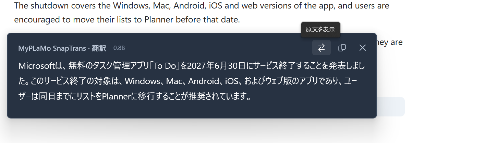
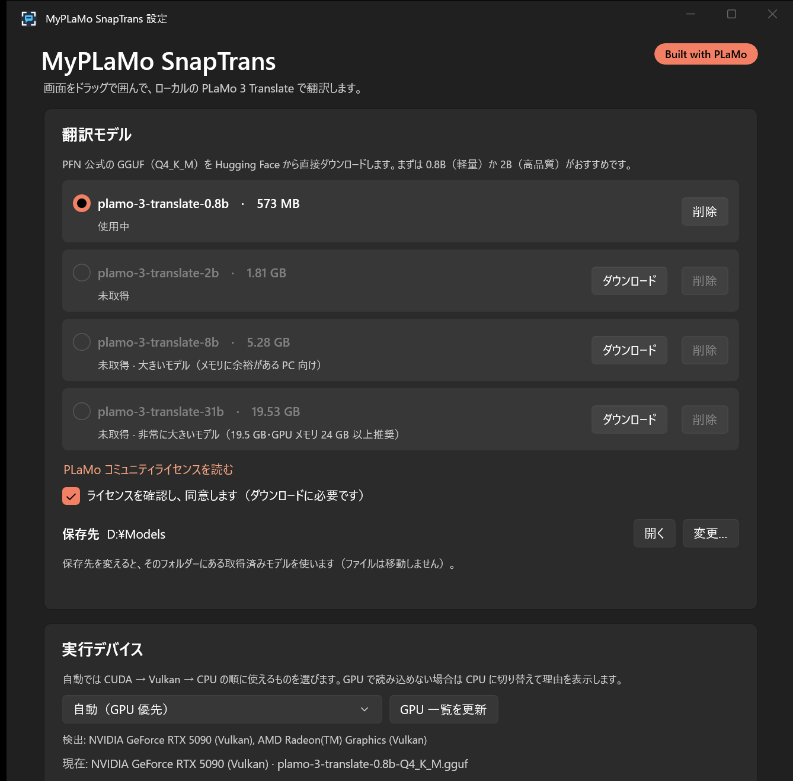
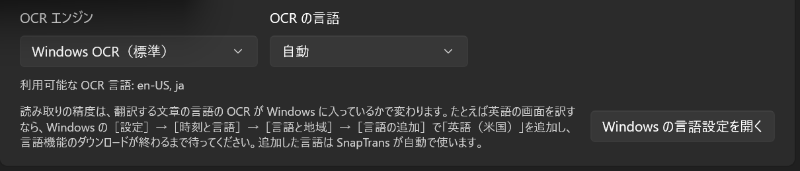

# MyPLaMo SnapTrans

[日本語](#日本語) | [English](#english)

**Built with PLaMo**

> 株式会社 Preferred Networks が公開した翻訳モデル「PLaMo 3 Translate」を使用する、個人開発の非公式アプリです。株式会社 Preferred Networks による提供・推奨・提携はありません。
>
> An unofficial, independently developed app that uses the PLaMo 3 Translate model released by Preferred Networks, Inc. It is not provided, endorsed, or affiliated with Preferred Networks, Inc.



---

## 日本語

### 概要

MyPLaMo SnapTrans は、画面の文字をドラッグで囲むと、その場で翻訳する常駐アプリです（Windows / macOS 対応）。

- 文字の読み取り（OCR）は Windows 版では Windows OCR（または任意の Tesseract）、macOS 版では Apple Vision を使用します。
- 翻訳は Preferred Networks の翻訳モデル **PLaMo 3 Translate** を [llama.cpp](https://github.com/ggml-org/llama.cpp) でローカル実行します。OCR も翻訳もすべてお使いの PC / Mac 内で完結し、文章を外部へ送信しません。
- 翻訳モデルは同梱していません。初回に設定画面でライセンスに同意したうえで、PFN の Hugging Face から利用者自身が直接ダウンロードします。




### ダウンロードと SHA-256 の確認

[Releases](../../releases) からお使いの OS に合った ZIP と `.sha256` ファイルをダウンロードします。

| OS | 配布ファイル | チェックサム |
| --- | --- | --- |
| Windows (64-bit x64) | `MyPLaMo-SnapTrans-<version>-win-x64.zip` | `MyPLaMo-SnapTrans-<version>-win-x64.zip.sha256` |
| macOS (Apple Silicon / arm64) | `MyPLaMo-SnapTrans-<version>-macos-arm64.zip` | `MyPLaMo-SnapTrans-<version>-macos-arm64.zip.sha256` |

ダウンロード後、必要に応じて SHA-256 ハッシュを `.sha256` ファイルと照合してください。

- **Windows（PowerShell）**:
  ```powershell
  Get-FileHash .\MyPLaMo-SnapTrans-1.2.0-win-x64.zip -Algorithm SHA256
  ```
- **macOS（ターミナル）**:
  ```bash
  shasum -a 256 ~/Downloads/MyPLaMo-SnapTrans-1.2.0-macos-arm64.zip
  # 同じフォルダーに .sha256 ファイルがある場合:
  shasum -a 256 -c MyPLaMo-SnapTrans-1.2.0-macos-arm64.zip.sha256
  ```

値が一致しない場合は ZIP を開かずに削除し、Releases からダウンロードし直してください。

---

### Windows 版

#### 動作環境

| 項目 | 内容 |
| --- | --- |
| OS | Windows 10 (2004 以降) / Windows 11、64 ビット (x64) |
| メモリ | 8 GB 以上を推奨（8B / 31B モデルはさらに必要） |
| GPU | 任意。Vulkan 対応の NVIDIA / AMD / Intel GPU で高速動作。NVIDIA GPU は設定から CUDA エンジンも導入可能。GPU がなくても CPU のみで動作 |
| ディスク | 本体 約 380 MB、モデル 0.6 GB（0.8B）〜 19.5 GB（31B） |
| ネットワーク | モデル（および任意の CUDA エンジン・Tesseract 辞書）のダウンロード時のみ必要 |

#### インストールと起動

1. ZIP を好きな場所（例: `C:\Tools`）に展開します。
2. `MyPLaMo-SnapTrans\MyPLaMo-SnapTrans.exe` を起動します（インストール・管理者権限・.NET や Windows App SDK の追加導入は不要）。
3. 通知領域（タスクトレイ）にアイコンが表示されます。`app\` フォルダーには本体とランタイム一式が入っているため、削除や移動はせずフォルダーごと置いてください。

##### 「Windows によって PC が保護されました」と表示されたら（SmartScreen）

コード署名されていないため、初回起動時に Microsoft Defender SmartScreen が「発行元: 不明」と警告することがあります。配布元（このリポジトリの Releases）を信頼できる場合は、「**詳細情報**」→「**実行**」で起動できます（ZIP のプロパティで「ブロックの解除」にチェックしてから展開しても警告は出なくなります）。

#### 使い方（Windows）

1. 初回は設定画面が開きます。PLaMo コミュニティライセンスを確認・同意し、モデル（まずは 0.8B か 2B）をダウンロードします。
2. **Ctrl + Alt を押しながら画面上の文字を左ドラッグ**で囲むと、OCR で読み取って翻訳し、ポップアップに表示します。
   - ドラッグ中に Esc でキャンセル。ポップアップは原文⇄訳文の切り替え、コピー、× または Esc で閉じられます。
3. 通知領域のアイコンをクリックすると設定が開き、右クリックで「設定を開く / 最後の翻訳を表示 / ドラッグ翻訳を有効にする / 終了」を選べます。


#### OCR 精度向上と GPU / CPU（Windows）

- **Windows OCR**: 翻訳したい言語の OCR が Windows に入っていると精度が上がります。英語画面を訳す場合は、Windows の **設定 → 時刻と言語 → 言語と地域 → 言語の追加** で **英語（米国）** を追加して言語機能のダウンロード完了を待ちます（設定画面の「Windows の言語設定を開く」ボタンから開けます）。任意の **Tesseract** への切り替えも可能です。
- **GPU / CPU**: 「自動」では CUDA（導入済みの場合）→ Vulkan → CPU の順に選択します。GPU メモリ不足などで読み込めない場合は自動で CPU に切り替え、理由を通知します。



#### アンインストール（Windows）

1. 「**サインイン時に起動する**」をオンにした場合は、アプリのフォルダーを削除（アンインストール）する前に設定画面でオフにしてください。オンのままフォルダーを移動したときは、次に起動したときに登録先が新しい場所に更新されます。
2. 通知領域のアイコンを右クリックして「**終了**」します。
3. 展開した `MyPLaMo-SnapTrans` フォルダーを削除します。
4. 設定・ログ・モデルなどのデータも消す場合は、`%LOCALAPPDATA%\MyPLaMo-SnapTrans` フォルダーと、別の場所を保存先にした場合はそのフォルダーのモデル（`*.gguf`）を削除します。レジストリには「サインイン時に起動する」の登録以外は書き込みません。

---

### macOS 版

#### 動作環境

| 項目 | 内容 |
| --- | --- |
| OS | macOS 15 以降 |
| CPU | Apple Silicon（M1 以降 / arm64） |
| メモリ | 8 GB 以上を推奨（31B モデルはユニファイドメモリ 32 GB 以上を推奨） |
| 推論 / OCR | Metal（GPU）優先・CPU 切替対応 / Apple Vision OCR |
| ディスク | 本体 約 35 MB、モデル 0.6 GB（0.8B）〜 19.5 GB（31B） |
| ネットワーク | モデルのダウンロード時のみ必要 |

#### インストールと起動

1. ZIP を展開します。
2. `MyPLaMo SnapTrans.app` を起動するか、`/Applications` フォルダーへ移動して起動します。メニューバーにアイコンが表示されます。

##### 署名なし Mac アプリの開き方

本アプリは Apple Developer ID による署名・公証を行っていません（配布用は ad hoc 署名＋Hardened Runtime）。初回起動時に macOS によってブロックされた場合は、「**システム設定**」→「**プライバシーとセキュリティ**」を開き、下部に表示される本アプリの案内から「**このまま開く**」→ 確認画面で「**開く**」を選択して起動してください。

##### 必要な許可の出し方

- **画面収録（必須）**: 選択範囲の文字を読み取るために使用します。「**システム設定**」→「**プライバシーとセキュリティ**」→「**画面収録**」で本アプリを許可してください（反映されない場合はアプリを再起動します）。macOS（ScreenCaptureKit）の仕様により、初回および**おおむね毎月**確認ダイアログが再表示されます（アプリ側で音声は取得しません）。
- **アクセシビリティ**: 修飾キー＋ドラッグ操作に必要です。「**システム設定**」→「**プライバシーとセキュリティ**」→「**アクセシビリティ**」で許可してください。未許可でも **Control + Shift + T** またはメニューバーの「**範囲を翻訳**」から翻訳できます。
- **更新版を入れたとき**: ad hoc 署名のためビルドごとにコード ID が変わります。更新版をインストールした際は、システム設定で「画面収録」「アクセシビリティ」の許可を付け直してください（一度オフ→オン、または一覧から削除して追加し直す）。

#### 使い方（macOS）

1. 初回は設定画面で PLaMo コミュニティライセンスを確認・同意し、モデル（まずは 0.8B か 2B）をダウンロードします。
2. **Control + Shift + ドラッグ**で範囲を囲むか、**Control + Shift + T**（またはメニューバーの「**範囲を翻訳**」）を実行すると、選択範囲を読み取って翻訳し、ポップアップに表示します。
   - Esc でキャンセル／ポップアップを閉じられます。ショートカットは設定画面で変更できます。
3. メニューバーのアイコンから設定・範囲翻訳・終了などの操作を行えます。

#### アンインストール（macOS）

1. 「**ログイン時に起動する**」をオンにした場合は、アプリを削除する前に設定画面でオフにしてください。
2. メニューバーのアイコンから「**終了**」します。
3. `MyPLaMo SnapTrans.app` を削除します。
4. データも消す場合は、`~/Library/Application Support/MyPLaMo-SnapTrans` と、別の場所を保存先にした場合はそのフォルダーのモデル（`*.gguf`）を削除します。必要に応じて「システム設定」の「画面収録」「アクセシビリティ」一覧からも本アプリを削除してください。

---

### モデルと安全のための仕組み

#### 翻訳モデル（PFN 公式 GGUF Q4_K_M）

| モデル | サイズ | 目安 |
| --- | ---: | --- |
| plamo-3-translate-0.8b | 0.57 GB | 軽量。まずはこれ |
| plamo-3-translate-2b | 1.8 GB | 高品質 |
| plamo-3-translate-8b | 5.3 GB | メモリに余裕がある環境向け |
| plamo-3-translate-31b | 19.5 GB | Windows は GPU メモリ 24 GB 以上、macOS はユニファイドメモリ 32 GB 以上を推奨 |

- モデルは設定画面から [PFN の Hugging Face](https://huggingface.co/pfnet) より直接ダウンロードします（中断・再開・SHA-256 検証対応）。他のアプリ（MyPLaMo など）とモデルフォルダーを共有することもできます。

#### 安全のための仕組み

- **ローカル完結**: OCR・翻訳ともに PC / Mac 内で処理し、翻訳対象や訳文を外部送信しません。
- **llama-server の分離**: Windows 版は `127.0.0.1` のランダムポート＋セッションごとの API キー（送信前に待受プロセスを照合）、macOS 版は所有者専用（`0700`）フォルダーの Unix ドメインソケット＋接続ごとの相手 PID 照合・セッションごとの API キーで通信します。
- **完全性検証**: 翻訳モデルや推論エンジンは SHA-256 を検証して使用します（macOS 版は、保存先にかかわらず、検証済みモデルの所有者専用コピー（`~/Library/Application Support/MyPLaMo-SnapTrans/engine-model`）から読み込みます。Mac 本体の APFS 上のモデルは容量を使わないクローン、別のディスクや共有フォルダー上のモデルはモデル 1 つ分の空き容量を使うコピーで、空きが足りなければ理由を表示して読み込みません）。
- **プライバシーに配慮したログ**: 診断ログには時刻・処理時間・言語・文字数・エラー種別などのみを記録し、読み取った本文・訳文・個人パス・認証トークンは出力しません。

---

### 開発者向けビルド手順

詳細なビルド手順・プロジェクト構成・開発用環境変数は、OS ごとのドキュメントを参照してください。

- Windows 版: [src/README.md](src/README.md)
- macOS 版: [macos/README.md](macos/README.md)

---

### ライセンス

- **MyPLaMo SnapTrans 本体**: [MIT License](LICENSE)（Copyright (c) 2026 MyPLaMo SnapTrans contributors）。株式会社 Preferred Networks による提供・推奨・提携はない個人開発の非公式アプリです。
- **翻訳モデル PLaMo 3 Translate**: モデルはこのリポジトリおよび配布 ZIP に含まれません。利用者が設定画面で同意したうえで PFN の Hugging Face から直接ダウンロードし、[PLaMo コミュニティライセンス契約](https://plamo.preferredai.jp/info/plamo-community-license-ja)（[English](https://plamo.preferredai.jp/info/plamo-community-license-en)）に従って使用します。
- **同梱ソフトウェア**: 配布 ZIP 内の `THIRD-PARTY-NOTICES.txt` を参照してください。Windows 版に同梱している Microsoft コンポーネント（Windows App SDK、.NET、Visual C++ ランタイムなど）はそれぞれの Microsoft のライセンス条件に従い、本アプリの MIT License はそれらの条件を変更するものではありません。

Built with PLaMo

---

## English

### Overview

MyPLaMo SnapTrans is a menu-bar / system-tray app for Windows and macOS that translates text on your screen in place when you drag a box around it.

- Text recognition (OCR) uses Windows OCR (or optional Tesseract) on Windows, and Apple Vision on macOS.
- Translation runs Preferred Networks' **PLaMo 3 Translate** locally with [llama.cpp](https://github.com/ggml-org/llama.cpp). Both OCR and translation run on your machine; your text is never sent anywhere.
- Models are not bundled. On first launch, you agree to the license in Settings and download a model directly from PFN's Hugging Face repositories.

### Download and SHA-256 verification

Download the ZIP and `.sha256` file for your OS from [Releases](../../releases).

| OS | Package | Checksum |
| --- | --- | --- |
| Windows (64-bit x64) | `MyPLaMo-SnapTrans-<version>-win-x64.zip` | `MyPLaMo-SnapTrans-<version>-win-x64.zip.sha256` |
| macOS (Apple Silicon / arm64) | `MyPLaMo-SnapTrans-<version>-macos-arm64.zip` | `MyPLaMo-SnapTrans-<version>-macos-arm64.zip.sha256` |

To verify the downloaded archive against its `.sha256` file:

- **Windows (PowerShell)**:
  ```powershell
  Get-FileHash .\MyPLaMo-SnapTrans-1.2.0-win-x64.zip -Algorithm SHA256
  ```
- **macOS (Terminal)**:
  ```bash
  shasum -a 256 ~/Downloads/MyPLaMo-SnapTrans-1.2.0-macos-arm64.zip
  # Or with the .sha256 file in the same folder:
  shasum -a 256 -c MyPLaMo-SnapTrans-1.2.0-macos-arm64.zip.sha256
  ```

If the hash does not match, delete the ZIP without opening it and download it again from Releases.

---

### Windows

#### Requirements

| Item | Details |
| --- | --- |
| OS | Windows 10 (version 2004 or later) / Windows 11, 64-bit (x64) |
| Memory | 8 GB or more recommended (more for 8B / 31B models) |
| GPU | Optional. Fast on Vulkan-capable NVIDIA / AMD / Intel GPUs; NVIDIA GPUs can also install the optional CUDA engine from Settings; runs on CPU alone as well |
| Disk | App ~380 MB; model 0.6 GB (0.8B) to 19.5 GB (31B) |
| Network | Only required when downloading models (and optional CUDA engine / Tesseract data) |

#### Install and launch

1. Extract the ZIP anywhere (for example `C:\Tools`).
2. Start `MyPLaMo-SnapTrans\MyPLaMo-SnapTrans.exe` (no installer, no administrator rights, and no separate .NET or Windows App SDK installation required).
3. An icon appears in the notification area (system tray). Keep the `app\` folder together with the launcher.

##### "Windows protected your PC" (SmartScreen)

Because the app is not code-signed, Microsoft Defender SmartScreen may warn "Unknown publisher" on first launch. If you trust the source (this repository's Releases), click **More info** and then **Run anyway** (ticking **Unblock** in the ZIP file's Properties before extracting also avoids the warning).

#### Usage (Windows)

1. On first launch, Settings opens. Review and agree to the PLaMo Community License, then download a model (start with 0.8B or 2B).
2. **Hold Ctrl + Alt and left-drag** a box around text on the screen to recognize and translate it in a popup.
   - Press Esc to cancel a drag or close the popup. The popup also lets you toggle original/translation and copy the text.
3. Click the tray icon for Settings, or right-click for **Open settings / Show last translation / Enable drag-to-translate / Exit**.

#### Improving OCR accuracy and GPU / CPU (Windows)

- **Windows OCR**: Accuracy depends on having the corresponding Windows OCR language pack installed. For English text, add **English (United States)** in Windows **Settings → Time & language → Language & region → Add a language** and wait until its language features finish downloading (accessible via **Open Windows language settings** in Settings). You can also switch to optional **Tesseract**.
- **GPU / CPU**: Automatic mode selects CUDA (if installed) → Vulkan → CPU. If the GPU cannot load the model (e.g., insufficient VRAM), it automatically falls back to CPU and reports why.

#### Uninstall (Windows)

1. If you turned on **Start at sign-in**, turn it off in Settings before deleting (uninstalling) the app folder. If you move the folder while it is on, the startup entry is updated to the new location the next time you start the app.
2. Right-click the tray icon and choose **Exit**.
3. Delete the extracted `MyPLaMo-SnapTrans` folder.
4. To remove data as well, delete `%LOCALAPPDATA%\MyPLaMo-SnapTrans` and any models (`*.gguf`) stored in a custom folder. Nothing is written to the Windows registry except the **Start at sign-in** entry.

---

### macOS

#### Requirements

| Item | Details |
| --- | --- |
| OS | macOS 15 or later |
| CPU | Apple Silicon (M1 or later / arm64) |
| Memory | 8 GB or more recommended (32 GB+ unified memory recommended for 31B) |
| Inference / OCR | Metal (GPU) preferred with CPU switch / Apple Vision OCR |
| Disk | App ~35 MB; model 0.6 GB (0.8B) to 19.5 GB (31B) |
| Network | Only required when downloading models |

#### Install and launch

1. Extract the ZIP archive.
2. Launch `MyPLaMo SnapTrans.app` directly or move it to `/Applications`. An icon appears in the menu bar.

##### Opening an unsigned Mac app

This app is not signed with an Apple Developer ID or notarized (distributed with ad hoc signing and Hardened Runtime). If macOS blocks it on first launch, open **System Settings** → **Privacy & Security**, click **Open Anyway** for MyPLaMo SnapTrans, and confirm **Open**.

##### Required permissions

- **Screen Recording (required)**: Used to capture the selected screen area. Grant permission in **System Settings** → **Privacy & Security** → **Screen Recording** (restart the app if it does not take effect). Due to macOS (ScreenCaptureKit) behavior, the confirmation prompt appears on first use and roughly **monthly**; the app does not capture audio.
- **Accessibility**: Required for modifier + drag selection. Grant permission in **System Settings** → **Privacy & Security** → **Accessibility**. Even without Accessibility permission, you can translate via **Control + Shift + T** or **Translate Area** in the menu bar.
- **After installing an update**: Because ad hoc signing changes the code identity with each build, re-grant **Screen Recording** and **Accessibility** in System Settings (toggle off/on, or remove and add again).

#### Usage (macOS)

1. On first launch, review and agree to the PLaMo Community License in Settings, then download a model (start with 0.8B or 2B).
2. Use **Control + Shift + drag** to select a region, or press **Control + Shift + T** (or choose **Translate Area** from the menu bar) to capture and translate it into a popup.
   - Press Esc to cancel or close the popup. Shortcuts can be customized in Settings.
3. Use the menu bar icon to open Settings, trigger area translation, or quit.

#### Uninstall (macOS)

1. If you turned on **Open at login**, turn it off in Settings before deleting the app.
2. Choose **Quit** from the menu bar icon.
3. Delete `MyPLaMo SnapTrans.app`.
4. To remove stored data as well, delete `~/Library/Application Support/MyPLaMo-SnapTrans` and any models (`*.gguf`) in a custom model folder. Optionally remove the app from **Screen Recording** and **Accessibility** in System Settings.

---

### Models and security measures

#### Translation models (PFN official GGUF Q4_K_M)

| Model | Size | Notes |
| --- | ---: | --- |
| plamo-3-translate-0.8b | 0.57 GB | Light; good starting point |
| plamo-3-translate-2b | 1.8 GB | Higher quality |
| plamo-3-translate-8b | 5.3 GB | For machines with ample memory |
| plamo-3-translate-31b | 19.5 GB | 24 GB+ VRAM on Windows / 32 GB+ unified memory on macOS recommended |

- Models are downloaded directly from [PFN on Hugging Face](https://huggingface.co/pfnet) via Settings (with pause/resume and SHA-256 verification). You can also point the model folder to another app's folder (such as MyPLaMo) to share models.

#### Security measures

- **Fully local**: Both OCR and translation run locally on your machine; source text and translations are never sent over the network.
- **Isolated llama-server**: On Windows, `llama-server` binds to a random port on `127.0.0.1` with a per-session API key (verifying the listening process before sending). On macOS, it listens on a Unix domain socket inside an owner-only (`0700`) directory, checking the peer PID on every connection along with a per-session API key.
- **Integrity checks**: Translation models and inference engines are verified via SHA-256 (on macOS, the engine always loads an owner-only verified copy of the model in `~/Library/Application Support/MyPLaMo-SnapTrans/engine-model`, whatever the model folder: a space-free clone for models on the Mac's APFS volume, a full copy for models on another disk or a shared folder, which needs free space for one more model; without it the reason is shown and the model is not loaded).
- **Privacy-conscious logging**: Logs record only timestamps, timings, languages, character counts, and error kinds—never recognized text, translations, personal file paths, or API tokens.

---

### Developer build guides

For build requirements, project layout, and developer environment variables, see the platform-specific guides:

- Windows: [src/README.md](src/README.md)
- macOS: [macos/README.md](macos/README.md)

---

### License

- **MyPLaMo SnapTrans**: [MIT License](LICENSE) (Copyright (c) 2026 MyPLaMo SnapTrans contributors). An unofficial, independently developed app not provided, endorsed, or affiliated with Preferred Networks, Inc.
- **PLaMo 3 Translate model**: Not included in this repository or in release ZIPs. Users agree to the license in Settings, download the model directly from PFN's Hugging Face repositories, and use it under the [PLaMo Community License Agreement](https://plamo.preferredai.jp/info/plamo-community-license-en) ([日本語](https://plamo.preferredai.jp/info/plamo-community-license-ja)).
- **Bundled software**: See `THIRD-PARTY-NOTICES.txt` in the release ZIP. Bundled Microsoft components on Windows (Windows App SDK, .NET, Visual C++ runtime, etc.) are subject to their respective Microsoft license terms; the MIT License of MyPLaMo SnapTrans does not modify those terms.

Built with PLaMo
